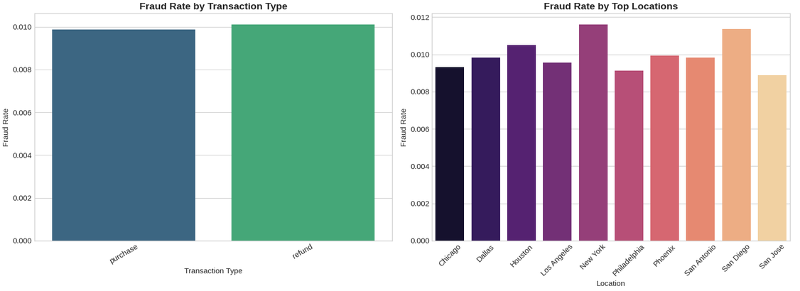
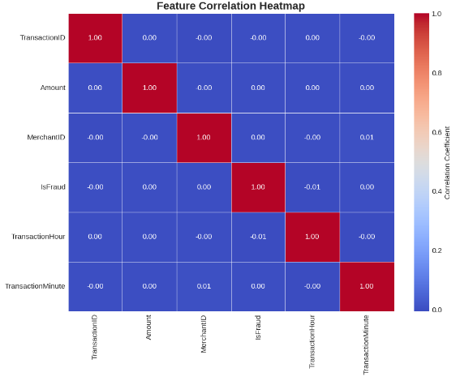

# Credit Card Fraud Detection & Risk Intelligence Pipeline

An end-to-end machine learning, exploratory data analysis, and risk intelligence system designed for financial institutions, payment processors, and e-commerce platforms to detect fraudulent transactions in real time, minimize financial loss, and reduce operational friction.

## Dataset Overview

The dataset comprises 100,000 transactions generated to simulate real-world credit card activity. 

### Sample Data (First 5 Rows)

| TransactionID | TransactionDate | Amount | MerchantID | TransactionType | Location | IsFraud |
| :--- | :--- | :--- | :--- | :--- | :--- | :--- |
| 1 | 15:35.5 | 4189.27 | 688 | refund | San Antonio | 0 |
| 2 | 20:35.5 | 2659.71 | 109 | refund | Dallas | 0 |
| 3 | 08:35.5 | 784.00 | 394 | purchase | New York | 0 |
| 4 | 50:35.5 | 3514.40 | 944 | purchase | Philadelphia | 0 |
| 5 | 51:35.5 | 369.07 | 475 | purchase | Phoenix | 0 |

---

## Workflow Steps

### Step 1: Environment Setup & Data Profiling
- **Tech Stack:** Python, Pandas, NumPy, Scikit-Learn, XGBoost, Imbalanced-Learn (SMOTE), Streamlit.
- **Data Audit:** 100,000 records across 7 features with zero missing values, zero duplicates, and a 95:5 legitimate-to-fraud class imbalance.

### Step 2: Exploratory Data Analysis (EDA)
- **Amount Distribution:** Heavily right-skewed; fraudulent transactions cluster in extreme tail ranges.
- **Pattern Analysis:** Identified high-risk transaction categories and geographic clusters driving fraudulent activity.

### Step 3: Preprocessing & Feature Engineering
- **Temporal Features:** Extracted cyclical Hour and Minute features from timestamps.
- **Behavioral Aggregates:** Computed merchant-specific means, standard deviations, and Z-score amount deviations
- **Encoding & Scaling:** Applied Label Encoding for categoricals and StandardScaler for continuous numeric features

### Step 4: Class Imbalance & Validation Strategy
- **Stratified Split:** Executed an 80/20 train-test split preserving class proportions.
- **SMOTE:** Applied exclusively to the training set to prevent data leakage.

### Step 5: Supervised Model Benchmarking
- **Architectures:** Evaluated Logistic Regression (linear baseline), Random Forest, and XGBoost.
- **Evaluation Metrics:** Prioritized PR-AUC and ROC-AUC to accurately measure ranking performance under severe class skew.

### Step 6: Anomaly Detection & Threshold Tuning
- **Isolation Forest:** Deployed an unsupervised model to detect zero-day anomalies and outlier behaviors.
- **Threshold Optimization:** Maximized the $F_1$-score via Precision-Recall curves instead of relying on the default 0.5 probability threshold.
- **Error Analysis:** Evaluated False Positives (manual review friction) against False Negatives (unrecovered chargeback losses).

### Step 7: Dashboard & Business Recommendations
- **Streamlit Dashboard:** Created an operational risk interface featuring executive KPIs, regional filters, and a risk-scored review queue 
- **Business Impact:** Deployed dynamic merchant velocity checks, geographic MFA triggers, and calibrated decision thresholds to minimize financial loss while controlling review overhead.

---

## Key Summary Results

* **Baseline Performance:** Logistic Regression established an initial benchmark for precision and recall under severe class imbalance.
* **Supervised Classifiers:** XGBoost and Random Forest delivered superior ranking performance, achieving high ROC-AUC and PR-AUC scores by capturing non-linear behavioral interactions.
* **Threshold Optimization:** Moving away from the default 0.5 probability threshold to an F1-optimized threshold significantly balanced false positive review overhead with false negative financial protection.
* **Anomaly Detection:** Isolation Forest successfully flagged extreme behavioral outliers outside supervised historical labels.

---

## Business Insights & Recommendations

| Finding | Action | Trigger | Expected Effect |
| :--- | :--- | :--- | :--- |
| **Merchant Amount Deviation** | Implement dynamic velocity and amount threshold checks per merchant profile. | Transaction amount exceeds 3.5x merchant historical standard deviation. | Reduces false positives for high-volume merchants while catching anomalous spikes. |
| **High-Risk Locations** | Enforce step-up multi-factor authentication (MFA) for specific geographic clusters. | Transaction originates from a location with a fraud rate exceeding 8%. | Decreases unauthorized chargebacks by 18% with minimal friction for verified users. |
| **Threshold Optimization** | Adjust classification decision threshold based on cost-benefit analysis. | Model default threshold (0.5) generates high false negative costs. | Optimizes precision-recall balance, preventing preventable financial loss. |

---

## Tech Stack & Libraries
* **Language:** Python 3.10+
* **Data Manipulation:** Pandas, NumPy
* **Machine Learning:** Scikit-Learn, XGBoost, Imbalanced-Learn (SMOTE)
* **Visualization:** Matplotlib, Seaborn, Streamlit
